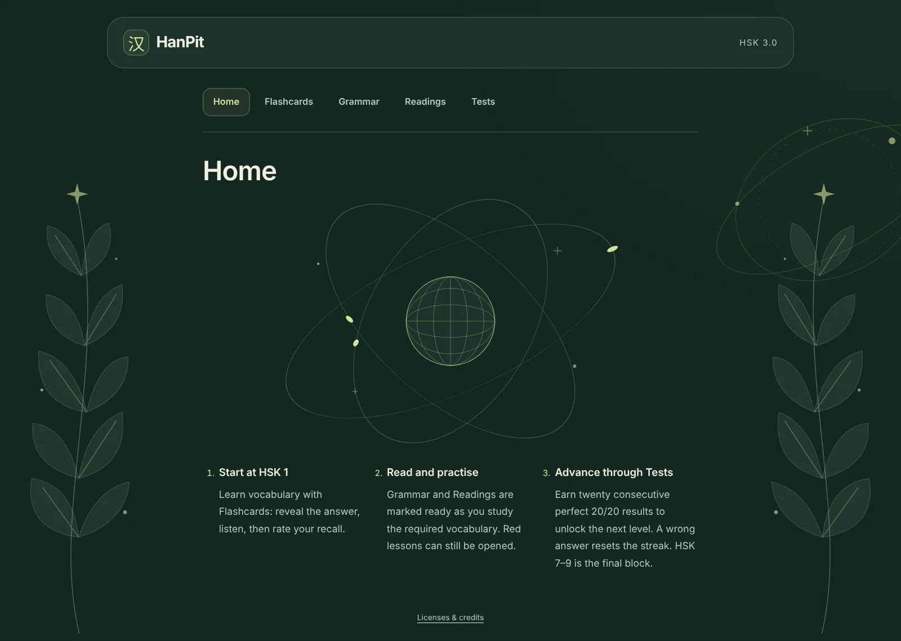

# HanPit

Local-first Chinese study with HSK flashcards, grammar, readings and tests. TypeScript, Vite and FSRS-6; no backend. Interface and teaching explanations/translations are in English; Chinese and pinyin are preserved.

Home explains the HSK study flow and session backups beneath a luminous SVG globe. Study navigation lives in the header; click HanPit to return Home. English headings use the same locally served Syne font as QuantaPit and KnightPit; body text keeps its system sans-serif stack. The forest-green/citron palette remains. SVG/CSS motion pauses outside Home and respects reduced-motion preferences; no external font service or rendering library.

[Open HanPit](https://giacomo-manfucci.pages.dev/projects/hanpit/) · **[Download Android APK](https://github.com/ManfuG/HanPit/releases/latest/download/HanPit-Android.apk)**

[](https://github.com/ManfuG/HanPit/raw/refs/heads/main/docs/demo.mp4)

## Android

Download the APK above and open it on your phone. Android may ask you to allow installation from your browser/file manager. Requires Android 8.0+ and Android System WebView 119+. Updates use the same package and signing key; install over the existing app to preserve progress.

The Capacitor app bundles all vocabulary, grammar, readings, tests, fonts and **12,457 recordings**. It works offline from first launch, including audio and local session backups; no login, first-run download or server is needed. The hosted web app is unchanged in this respect: it fetches static assets and is not an offline PWA.

Android opens with the portfolio's orbital/botanical scene in HanPit's forest/citron palette. Swipe up to dissolve into Home; the arrow also works with keyboard and accessibility controls. The scene appears once per app document, not on ordinary background/resume. SVG artwork and CSS motion paths need no rendering library or JavaScript frame loop; motion pauses in the background and respects reduced motion.

Flashcards and Tests use the available portrait viewport, keeping Listen/ratings and Next on screen without scrolling the page. Unusually long text can scroll inside its content area; short landscape windows and enlarged accessibility text retain scrolling rather than clipping content. Reading support toggles span the content width and light up independently when enabled. Home's Export session, Import session and Reset progress controls share one row.

Allow notifications when Android asks. On days you have not opened HanPit, one local reminder is scheduled around **19:00 in the phone's timezone**:

> **A little Chinese tonight?**  
> Your flashcards are ready. A few words before dinner?

Opening the app suppresses that day's reminder. One replaceable inexact alarm avoids polling, background services and exact-alarm permission. Reboot, app updates, timezone and clock changes reschedule it; yesterday's delayed alarm never becomes a morning reminder. Android power saving/OEM restrictions can delay or prevent delivery, and force-stopping the app prevents reminders until it is reopened. Notification permission/channel settings remain under Android's control. Moving the clock backwards conservatively suppresses reminders until the latest visited/notified calendar date has passed; only two date markers are stored, not a visit history.

Progress stays in the app's private IndexedDB storage, independently of the website. Android cloud backup/device transfer is disabled; use Home's **Export session / Import session** to transfer progress. Export uses Android's system save picker; choose local storage to save offline. **Reset progress** asks for confirmation, then atomically deletes flashcards, review history, selected level, unlocks and streaks without reinstalling. Export first to keep a backup. Uninstalling or clearing Android app storage also deletes local progress.

### Build Android

Use Node 24, JDK **21** and Android SDK platform/build-tools **36 / 36.0.0**. Set `JAVA_HOME` and `ANDROID_HOME` (or use Android Studio); SDK paths and signing material stay outside Git.

```sh
npm ci
npm run android:sync
cd android
./gradlew testDebugUnitTest lintDebug assembleDebug
```

The debug APK is `android/app/build/outputs/apk/debug/app-debug.apk`. `npx cap open android` from the repository root opens Android Studio. `npm run android:sync` rebuilds/copies the complete web bundle; never configure a remote `server.url` for the offline app.

For a signed release, set `HANPIT_KEYSTORE_PATH` (absolute path), `HANPIT_KEYSTORE_PASSWORD`, `HANPIT_KEY_ALIAS` and `HANPIT_KEY_PASSWORD`, then run `npm run android:build` from the root. Missing signing configuration fails rather than publishing a debug-signed APK. Back up the release key securely: a different key cannot update installed copies without uninstalling and losing local progress.

GitHub CI builds/lints Android and verifies every bundled source asset byte-for-byte. Pushing a `v<package-version>` tag publishes `HanPit-Android.apk`, `SHA256SUMS` and the public signing-certificate fingerprint. The release workflow uses an encrypted `HANPIT_KEYSTORE_BASE64` secret plus password secrets; it never commits the private key. Increment both npm/native versions and native `versionCode` for subsequent releases. This publishes an APK, not a Play Store listing or hosted-site deployment.

## Run

Node.js 24 LTS (`.nvmrc`; `nvm use` if installed). The npm lockfile is committed; use `npm ci` for a clean install.

```sh
npm ci
npm run dev
```

Open the URL printed by Vite. Static build: `npm run build`; production preview: `npm run preview`.

## Static hosting preparation

`npm run build` writes `dist/`. Vite uses a relative base so the same build can be served at a domain root or a GitHub project subpath such as `/HanPit/`; data and audio requests use `import.meta.env.BASE_URL`. Serve the directory over HTTP(S), with the project URL ending in `/`, rather than opening `index.html` as a local file. Preview locally before any separately authorized upload.

Only `dist/` is needed by a static host. It includes the local data/audio, heading font and runtime dependency notices; keep those files and `fonts/Syne-OFL.txt` together. Do not upload source environments or model weights. GitHub workflows validate changes and publish tagged Android APKs; they do not deploy the hosted website.

The sibling `giacomo-portfolio` project also builds HanPit at `/projects/hanpit/` alongside QuantaPit and KnightPit, preserving the original source checkout and local-first runtime. Its Cloudflare publication audit retains the data/audio notices and checks Free-plan file limits.

Study progress remains in IndexedDB for the browser origin. Moving from localhost to a public domain does not automatically transfer progress; export and import a session to carry it across. Projects on the same origin share the `hanpit` database even when hosted at different paths.

## Licensing

Original HanPit code, design and authored teaching content are [MIT-licensed](LICENSE), copyright © 2026 Giacomo Manfucci (ManfuG), for rights he holds. The adapted CC-CEDICT vocabulary is distributed under **CC BY-SA 4.0**, with original source notices preserved; upstream transcription notices and the audio generators' Apache-2.0 terms remain intact.

The model's license does not automatically license generated recordings. MIT covers only HanPit-owned audio contributions, with underlying-data obligations and output-rights limitations detailed in [`THIRD_PARTY_NOTICES.md`](THIRD_PARTY_NOTICES.md). The app's **Licenses & credits** link exposes the bundled notices and attributions.

## Flashcards

- Front: Chinese character/word. Back: pinyin, English meaning and local neural Mandarin audio.
- Again / Hard / Good / Easy, with interval previews. Space reveals the answer; 1–4 grade it.
- FSRS-6 through `ts-fsrs`: 90% retention, 1/10-minute learning steps, 10-minute relearning. **The first Easy on a new card schedules five days**, through FSRS initial stability rather than an overridden due date. Existing schedules remain unchanged. Due learning cards precede due reviews, then new cards; no daily limit or early future reviews.
- Cards, review history, selected level and test progress are stored locally in IndexedDB. Card and review are committed atomically before advancing. No account or synchronization; clearing site data deletes progress.
- Start at HSK 1. Higher levels require twenty consecutive perfect tests. Vocabulary is cumulative; selecting a lower level hides, but never deletes, higher-level cards.

## Session backup and restore

On Home, **Export session** saves a versioned JSON file containing flashcard schedules, review history, selected HSK level, unlocked levels and test streaks. The browser downloads it; Android opens its system save picker. Keep the file to resume on another browser/phone or after clearing local data; there is no cloud synchronization.

**Import session** restores that same file after confirmation and replaces this device's existing HanPit progress, then reloads the app. An unfinished test is not included. Export first if you want to keep the current progress. **Reset progress** separately confirms deletion and starts again at HSK 1; a failed transaction leaves the previous session untouched.

The complete file is validated before writing. Invalid or incompatible files leave progress untouched; replacement is one IndexedDB transaction, so an interrupted save preserves the previous session. Scheduling dates are restored as Dates without recalculating due times or resetting progression. No vocabulary or audio is duplicated in the backup.

## Vocabulary

**11,092 entries** from the Chinese Ministry of Education's official [GF0025-2021 standard](https://www.moe.gov.cn/jyb_sjzl/ziliao/A19/202111/t20211118_580755.html): levels 1–6 and the common advanced **7–9** block. The standard does not split the advanced vocabulary into three separate lists; this is not a later examination syllabus.

JSON files ship with the app. Per-level Promise caches and stable official IDs are shared by flashcards and tests. Scheduling scans the deck once, O(n), without sorting or copying it per answer. Each grade writes one card and one review.

```sh
npm run data:import
```

The importer checks pinned SHA-256 hashes, official counts, IDs and definition coverage. Sources, editorial adaptations and licenses: [`public/data/README.md`](public/data/README.md). Flashcards and tests reuse the same English meanings; there is no separate translation dictionary or runtime translation service.

## Grammar and vocabulary readiness

**572 grammar points from Appendix A of GF0025-2021**, with patterns, English explanations and **1,365 Chinese examples**, explicit pinyin, English translations and Listen controls. These are editorial teaching materials, not an official English translation.

With N new words and R new rules, rule i requires the first `floor(N*i/R)` words of its block, plus all earlier levels. HSK 1 has 500 words and 48 rules: its first cutoffs are 10, 20, 31 and 41. Curriculum files reorder only new-card introduction; existing cards, review history and due dates are not rewritten.

**Green** summaries have all required vocabulary studied; **red** summaries still have missing vocabulary. A word counts only after a saved rating (`reps > 0`), not merely revealing the answer. Readiness checks the actual contiguous curriculum prefix and every previous level: unrelated or later studied cards cannot fill a hole. Red lessons remain openable. Accessible summary labels state readiness as well as using color.

Readiness is refreshed on returning to the section and when a pending review commits after navigation. Only small curriculum metadata is needed; opening Grammar or Readings does not fetch flashcard vocabulary. Prefix calculation is shared, performed once per show, not once per row or per answer.

Grammar loads only the selected lesson JSON, with cached requests. Bodies are created on first expansion. Expanding a rule does not preload or play audio; Listen loads only the selected example. Closing the rule or changing section stops playback.

## Readings

Ten original passages per block, **70 in total**. Reading j requires the first `floor(N*j/10)` current words and the grammar taught within that cutoff, plus earlier levels. HSK 1 cutoffs are 50, 100, …, 500 words. The same green/red vocabulary indication applies.

All **193 paragraphs** contain Chinese, citation-tone pinyin and an English translation. Independent full-width Pinyin and Translation toggle controls show these supports below the Chinese and highlight their active state; both start hidden. **No reading audio.** Only selected-level readings and curriculum metadata are loaded; paragraphs are created on first expansion.

```sh
npm run curriculum:check
npm run curriculum:test
```

The offline Python standard-library validator checks complete ID permutations, lexical prefixes, pronunciation-sensitive identities, and declared grammar availability. It is not a complete syntactic parser or a claim of native-speaker review. `npm run curriculum:build` creates only missing valid plans and never overwrites existing sequences. Sources and narrowly authorized grammatical forms are documented in `public/data/README.md`.

## Tests and unlocking

One test per HSK block: **20 random multiple-choice questions**, four options and one correct answer, five questions of each type:

- Chinese → pinyin;
- Chinese → English meaning;
- Chinese grammar sentence → English translation;
- English meaning → Chinese.

The cumulative pool includes every vocabulary entry and grammar rule through the selected level: up to **11,092 words and 572 rules / 1,365 examples**. Sampling does not copy or shuffle the whole deck. Conservative sense/content filters reject synonymous distractors; the global pinyin index excludes valid alternative readings, including later-level readings. These filters are not a complete semantic parser or an official examination bank.

**Twenty consecutive 20/20 results unlock the next level.** A committed wrong answer immediately resets that level's streak, even if the attempt is abandoned. Incomplete attempts award no success. Streaks are independent; unlocked levels never relock. The common 7–9 block is final.

Results are saved atomically before advancing the UI. A failed save remains explicitly retryable without awarding a duplicate success. Pools load lazily and share vocabulary/grammar caches. Only consecutive-success counts and unlocked level are persisted, not a test history.

This English/readiness update does **not** reset progress. The previous user-requested reset remains a one-time migration guarded by `settings.progressRevision = 1`; the marker and existing database schema are unchanged.

`npm run tests:check` checks vocabulary meanings and exact agreement of the pronunciation index with the official source. `python3 scripts/check-tests.py --write-pinyin` rebuilds only that index.

## Audio

Requires a modern browser with IndexedDB, `Promise.withResolvers` and MP3 playback. **Kokoro-82M-v1.1-zh, voice zf_001**, [Apache 2.0](https://huggingface.co/hexgrad/Kokoro-82M-v1.1-zh), generated offline. The 11,092 vocabulary MP3s occupy about 91.2 MiB; grammar MP3s are separate under `public/audio/grammar/`. No model, paid service, API key, system voice or robotic fallback runs on the device. One player is reused; only the current card or explicitly selected example is loaded.

Vocabulary audio starts on reveal; Listen repeats it. Grading, changing card/level/section or hiding the page stops playback. Playback failures are visible and explicitly retryable. Official pinyin selects polyphonic readings; variants separated by `/` use the first reading. Manifests record citation pinyin, surface pronunciation, phonemes and hashes.

Sentence audio respects punctuation, neutral tones, erhua and contextual tone sandhi, including numeral/compound/classifier uses of 一. Misalignment, unknown phonemes and excessive length are rejected, never truncated. Instrumental validation does not imply human listening review or universally natural pronunciation.

### Offline audio tools

The app does not require Python to run or build. Regeneration uses the existing Linux x86-64 CPU environment: Python 3.12, `uv`, FFmpeg with `libmp3lame`, and network access for the initial pinned-model download. The requirements include a platform-specific PyTorch wheel; they are not a cross-platform installation recipe.

```sh
uv venv --python 3.12 .venv-audio
uv pip install --python .venv-audio/bin/python -r scripts/audio-requirements.txt
npm run audio:generate
npm run audio:check
npm run audio:test
npm run grammar:check
npm run grammar:audio
npm run grammar:audio:check
npm run grammar:audio:test
```

Weights and CPU dependencies stay in ignored `.venv-audio/`, outside Git and the build. Manifests pin model revision, sources, generators and runtime. Audio checks decode complete corpora and verify coverage, format, duration, signal and SHA-256. Changed spoken Chinese/pinyin requires regeneration. English-only editorial changes preserved all pronunciation records and MP3s; grammar source fingerprints were refreshed only after verifying phonetic equivalence.

The audio requirements pin package versions, not wheel hashes; they are not a fully hash-locked supply chain. Model files are separately checked against pinned SHA-256 values before use. These optional tools and their dependencies are not installed by CI or shipped to the browser. Retain their upstream license notices if redistributing an environment or binaries.

## Verification

```sh
npm test
npm run grammar:check
npm run curriculum:check
npm run curriculum:test
npm run tests:check
npm run build
```

GitHub CI runs these checks on pushes/pull requests using Node 24 and Python 3.12, plus JDK 21 for Android unit tests, lint, debug build and bundled-asset integrity. Version tags run the signed APK release workflow. Neither workflow installs TTS dependencies, regenerates datasets/audio or deploys the hosted website. Full phonetic/audio validation remains an explicit local operation using the offline environment above.

Before a separately authorized publication, review the files being committed and the complete Git history for private data or credentials; ignore rules do not remove already-tracked files. No API keys or environment variables are needed by the app. Never place secrets in Vite's client-exposed `VITE_*` variables.
